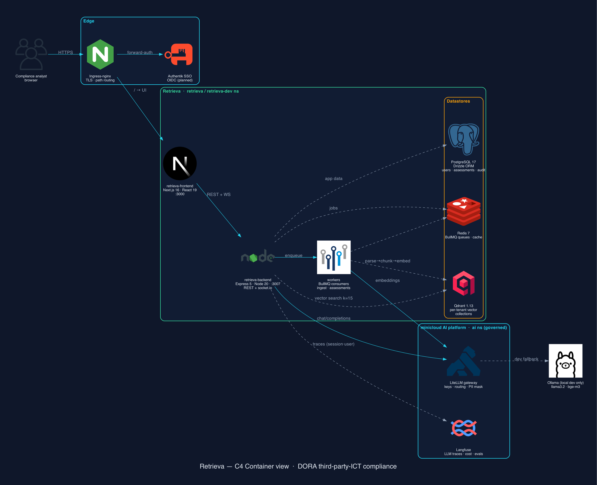

# Retrieva

**DORA Compliance Intelligence for Financial Entities**

Retrieva automates third-party ICT risk assessments under **DORA (Regulation EU 2022/2554)**: upload
vendor documentation, get a structured compliance gap report in minutes, and ask follow-up questions to
an AI copilot grounded on your documents and the built-in DORA knowledge base.

**Docs:** [andrelair-platform.github.io/retrieva](https://andrelair-platform.github.io/retrieva/) · **Live:** [retrieva.online](https://retrieva.online)

> **Repo layout (post-split, RFC #474).** This repository is the **frontend** (Next.js) + the docs +
> the local-run `docker-compose.yml`. The **backend** (Express 5 + Drizzle/PostgreSQL + LangChain RAG API)
> lives in **[andrelair-platform/retrieva-backend](https://github.com/andrelair-platform/retrieva-backend)**.
> The one-command local run below builds both.

---

## 🚀 Run the whole application locally (reviewers / certification jury)

This is the recommended way to evaluate Retrieva: **one command, zero config, no API key, no cluster.**
Everything (database, vector store, queue, AI models, backend, frontend) runs in Docker on your machine.

### Prerequisites

- **Docker Desktop** (or Docker Engine + Compose v2) — that's the only requirement.
- **git**, and **~8 GB free disk + ~6 GB free RAM** (a small chat LLM runs locally).

### 1. Clone BOTH repos **side by side** (same parent folder)

```bash
mkdir retrieva-eval && cd retrieva-eval
git clone https://github.com/andrelair-platform/retrieva.git
git clone https://github.com/andrelair-platform/retrieva-backend.git
```

You should have:

```
retrieva-eval/
├── retrieva/            # this repo (frontend + docker-compose.yml)
└── retrieva-backend/    # the API (built automatically by compose)
```

### 2. Start everything

```bash
cd retrieva
docker compose up
```

That single command:
1. starts **PostgreSQL, Redis, Qdrant, Ollama**;
2. pulls the **AI models** (`bge-m3` embeddings + `llama3.2:3b` chat) — *first run only, ~2–3 GB*;
3. builds + starts the **backend** (it **auto-applies database migrations** on boot);
4. runs a one-shot **seed** of the DORA knowledge base + control library;
5. builds + starts the **frontend**.

> **First run takes a few minutes** (model download + image builds). Later runs start in seconds.
> When you see the frontend become healthy, you're ready.

### 3. Open the app

Go to **[http://localhost:3000](http://localhost:3000)** → register an account → create a workspace →
upload a vendor document (PDF/DOCX) to run your first DORA gap analysis, or ask the copilot a question.

### AI model — keyless by default, optional override for speed

The backend reaches the chat LLM through an **OpenAI-compatible AI gateway** — in production the
self-hosted **minicloud LiteLLM gateway** (provider routing, key rotation, retries, PII masking,
budgets, EU governance). For this local run it points at the **local Ollama** OpenAI-compatible
endpoint, so the copilot runs **keyless and offline**. On a modest laptop the local model can be slow.
**For faster answers (optional)**, point it at a real gateway or a free provider via a `.env` next to
`docker-compose.yml` (`retrieva/.env`), then `docker compose up` again:

```bash
# retrieva/.env  — optional, for a real gateway or faster chat
LITELLM_BASE_URL=https://api.groq.com/openai/v1
LITELLM_API_KEY=gsk_your_free_groq_key
LLM_MODEL=llama-3.3-70b-versatile
```

Embeddings always run locally (`bge-m3`), so document ingestion never needs a key.

### Ports & services

| Service | URL / Port | Role |
|---|---|---|
| Frontend | http://localhost:3000 | the app you use |
| Backend API | http://localhost:3007 | REST + RAG (`/health`, `/api/v1`) |
| PostgreSQL | localhost:5432 | application data (Drizzle) |
| Qdrant | localhost:6333 | vector store |
| Redis | localhost:6378 | cache / BullMQ queues |
| Ollama | localhost:11434 | local chat + embedding models |

### Troubleshooting

```bash
docker compose logs -f backend        # watch backend (migrations, boot)
docker compose logs -f seed           # watch the DORA knowledge-base seeding
docker compose ps                     # service health
docker compose down -v && docker compose up   # full clean reset (wipes volumes)
```

- **A port is already in use** → stop the conflicting local service, or edit the `ports:` in `docker-compose.yml`.
- **Copilot answers slowly / times out** → use the optional free key above (local LLM is CPU-bound).
- **Re-run the knowledge-base seed** → `docker compose run --rm seed`.

---

## Architecture



> **C4 container view**, generated from code ([`docs/diagrams/retrieva_container.py`](docs/diagrams/retrieva_container.py) — mingrammer `diagrams` + Graphviz). Full write-up: **[Solution Architecture → C4 Container](https://andrelair-platform.github.io/retrieva/architecture/solution-architecture)**.

<details>
<summary>Text view</summary>

```
            ┌──────────────┐            ┌──────────────┐
 Reviewer ─▶│   Frontend   │ ── API ──▶ │   Backend    │   (this repo)   (retrieva-backend)
 (browser)  │  Next.js 16  │            │  Express 5   │
            └──────────────┘            └──────┬───────┘
                                               │
                 ┌──────────────┬──────────────┼──────────────┐
                 ▼              ▼               ▼              ▼
          ┌────────────┐ ┌────────────┐ ┌────────────┐ ┌────────────┐
          │ PostgreSQL │ │   Qdrant   │ │   Redis    │ │   Ollama   │
          │ (Drizzle)  │ │ (vectors)  │ │ (queue)    │ │ (LLM+embed)│
          └────────────┘ └────────────┘ └────────────┘ └────────────┘
```

</details>

**Gap analysis:** `upload → BullMQ worker → parse → chunk → embed (bge-m3) → Qdrant → LLM gap analysis → structured report`
**RAG Q&A:** `question → multi-query + HyDE → Qdrant (k=15) → cross-encoder re-rank (RRF) → LLM answer + citations`

> **Production** runs on the self-hosted **minicloud k3s** cluster via **GitOps (ArgoCD + Kargo)** —
> not via this compose (which is for local evaluation/dev only).

---

## Tech stack

| Layer | Technology |
|---|---|
| Frontend | Next.js 16, React 19, TypeScript, Tailwind CSS, shadcn/ui, Zustand, React Query |
| Backend | Express 5, Node.js 20, BullMQ, LangChain (LCEL) |
| Database | **PostgreSQL + Drizzle ORM** |
| Vector store | Qdrant |
| Cache / queue | Redis, BullMQ |
| LLM (chat) | via an OpenAI-compatible **AI gateway** (prod: self-hosted **LiteLLM** — routing, key rotation, PII masking, budgets, EU governance); local run points it at Ollama |
| Embeddings | self-hosted Ollama `bge-m3` (1024-dim), OpenAI fallback |
| Auth | JWT (httpOnly cookies), bcrypt, AES-256 field encryption |
| Observability | Langfuse (LLM traces + cost) · Prometheus / Grafana |
| Delivery | Docker, GHCR, GitHub Actions CI/CD, ArgoCD + Kargo (GitOps on minicloud k3s) |

---

## Features

Retrieva covers the **financial entity's side of DORA Pillar 4 (ICT third-party risk management)** as a
coherent, human-in-the-loop lifecycle — *discover → classify & assess → evidence & decide → register &
monitor* — not a pile of isolated forms. The arrangement graph *is* the Register of Information.

| Feature | Description |
|---|---|
| **DORA gap analysis** | Upload vendor ICT docs → evidence-grounded, cited gap report mapped to DORA articles (AI drafts; a human checker decides under maker≠checker SoD) |
| **Multi-source ingestion** | PDF / DOCX / XLSX upload, URL crawling — indexed into a per-tenant vector store |
| **DORA copilot (RAG Q&A)** | Natural-language compliance questions, grounded on your docs + the DORA knowledge base, with citations |
| **Register of Information** | RT.01–04 + B_01/02 projection generated from the arrangement graph, with on-demand export |
| **Register data-quality (ESA)** | Validity checks the Register is filed against (ITS 2024/2956): LEI (ISO 17442 + ISO 7064 checksum), ISO 3166 country, cross-template referential integrity — each traced to the regulation |
| **Decision inbox + finding routing** | One cross-arrangement queue of AI-drafted findings + open risks; an approved gap is **routed to the owning party** (security / DPO / legal / ICT-risk), escalating to the management-body delegate on a severe critical/important finding, and the holders are notified |
| **Event-driven reassessment** | A material change on re-ingestion — a subprocessor added/removed, or a data-residency move — **reopens the arrangement** for a fresh assessment (the change trigger, twin of the periodic cadence) |
| **Audit readiness** | A tamper-evident, on-demand **evidence pack** per arrangement + a readiness **dashboard** (overdue reassessments, evidence freshness, register coverage, upcoming deadlines) |
| **Concentration & nth-party** | Sub-chain (nth-party) extraction + concentration/single-point-of-failure analysis across the provider graph |
| **Continuous monitoring** | CTPP surveillance (status-page incidents + CVE feeds) + periodic re-assessment on a cadence |
| **Workspace isolation** | Multi-tenant: each workspace isolated at the DB and vector-store layer |
| **Enterprise security** | PII masking, prompt-injection detection, output sanitisation, httpOnly JWT, AES-256 field encryption |

---

## Frontend development (this repo)

For UI-only work you can run just the frontend against a running backend:

```bash
npm install            # root npm workspace (installs frontend deps)
npm run dev            # Next.js dev server on http://localhost:3000
npm run lint
npm test
```

Backend development lives in **[retrieva-backend](https://github.com/andrelair-platform/retrieva-backend)**
(its own README, tests and scripts).

---

## Documentation

Full documentation (architecture, security, API reference, and the **RNCP39583 certification** dossier)
is published at **[andrelair-platform.github.io/retrieva](https://andrelair-platform.github.io/retrieva/)**.

## License

MIT — see [LICENSE](LICENSE).
