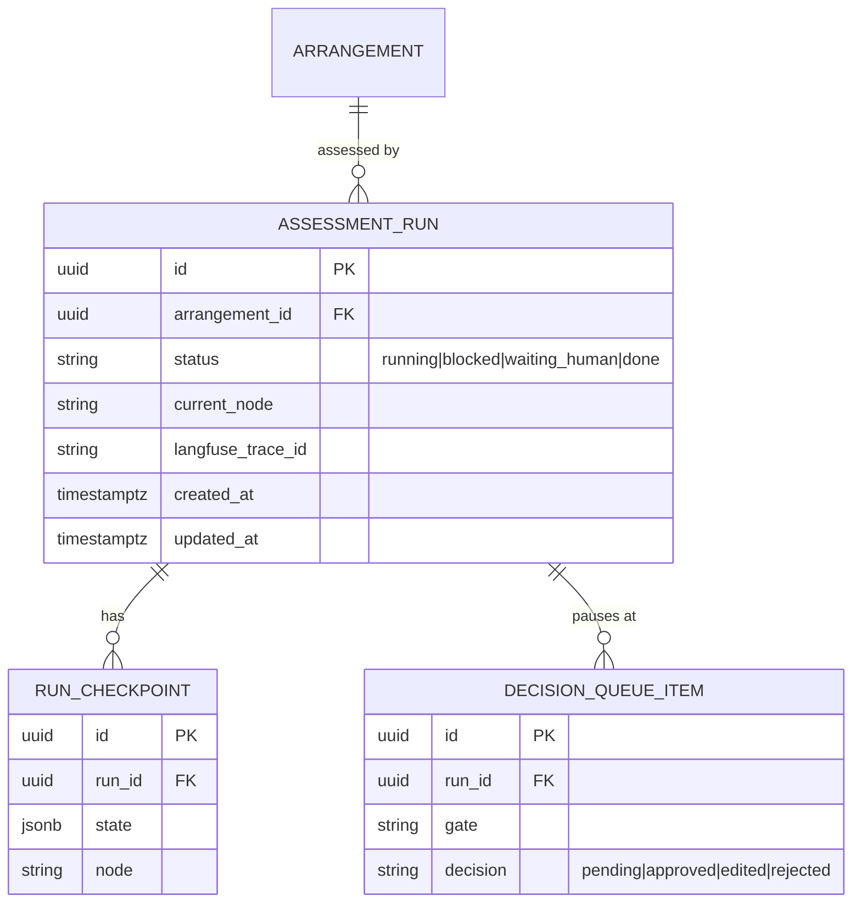

# Agentic Assessment Orchestrator — SDD

> **System Design Document** for Retrieva's multi-agent DORA-assessment capability. It follows the
> house SDD template (`sdd-template.md`) — three audience views, C4, NFR register, data design, the
> A2A contract, operational/scaling, security/compliance, a decision log. It **extends** the product
> [Solution Architecture](./solution-architecture.md) (it does not duplicate it) and **reconciles**
> the committed orchestrator epic **RTV-76** with the multi-framework agent direction (LangChain +
> LangGraph + CrewAI + A2A, human-in-the-loop).
>
> - **Product / repo(s):** Retrieva — `retrieva-backend` (supervisor) + **`retrieva-assessment-crew`** (new, Python crew)
> - **Owner (SA/TL):** AndreLiar · **Status:** draft · **Date:** 2026-10-13
> - **Delivery path:** C (full) · **Board:** #2 (Retrieva — RNCP39583) · **Initiative:** Certification
> - **Cert evidence:** **Bloc 2 (Concevoir & développer)** primary · **Bloc 4 (Maintenir en condition opérationnelle)** (resumable runs, eval, observability)

---

## 0. The reconciliation (read this first)

RTV-76 committed a **deterministic LangGraph `StateGraph`, in-process, no autonomous swarm, no
LLM-chosen routing** — because *deterministic routing + human-gated verdicts* is the argument that
makes Retrieva **defensible under DORA + the EU AI-Act** (not "a GPT wrapper"). That reasoning is
load-bearing for the certification and is **preserved here unchanged**.

This capability adds genuine **agent collaboration** *without* spending that defensibility, by being
precise about **where autonomy lives**:

| Layer | Behaviour | Why it's safe |
|---|---|---|
| **Routing** (the supervisor) | **Deterministic** — edges conditional on *data*, never an LLM | Auditable spine; RTV-76 constraint kept |
| **One node** (assessment) | **Collaborative CrewAI crew** (clause-mapper ↔ gap-analyst ↔ control-scorer) | Bounded; its output is *proposed*, not authoritative |
| **Every verdict** | **Human gate** (`interrupt()` → `decisionQueue`) | Maker/checker SoD; nothing partial becomes authoritative |

**Autonomy is confined to a single node whose output a human must approve.** That is the whole design.

---

## 1. Conceptual view — what it does & why it matters  *(PM / stakeholder / new hire)*

A compliance owner clicks **"assess this vendor for DORA"**. Behind that one action, a **supervisor**
walks a fixed pipeline — read the contract/evidence → classify the arrangement → a **team of
specialist agents collaborates** to map contract clauses to DORA controls, find the gaps, and score
them → build the risk/register view → assemble a **cited dossier**. The supervisor **pauses at each
decision point** and waits for a human to approve, edit, or reject; only then does it continue. The
human stays **accountable for every decision**; the machine does the legwork and shows its evidence.

The novelty vs. today: the specialist steps **collaborate as a crew** on the hardest sub-task
(clause→control→gap→score) instead of a human clicking each one in isolation — while the **routing
stays deterministic** and **every output is human-gated**. That combination is the certification
story: *agentic where it adds value, deterministic and human-accountable where it must be.*

It runs **on** the ktayl-solution IS (self-hosted k3s), reuses Retrieva's existing AI substrate
(LiteLLM, Qdrant, Langfuse), and produces **one auditable run per vendor**.

---

## 2. Requirements

### 2.1 Functional
- **F1** One action starts a full assessment run for an arrangement (vendor × supported function).
- **F2** A **deterministic supervisor** (LangGraph-JS `StateGraph`) sequences existing services as
  nodes; edges are conditional on *data* (e.g. *critical tier → committee gate*). **No LLM routing, no ReAct/`bindTools`.**
- **F3** The **assessment node** delegates to a **CrewAI crew** (clause-mapper → gap-analyst →
  control-scorer) over **A2A**; the crew is evidence-grounded and defaults to *"insufficient evidence"*.
- **F4** **Human-in-the-loop** `interrupt()` gates at: confirm arrangement · confirm nth-party edges ·
  approve findings (maker/checker) · final sign-off — surfaced through the existing `decisionQueue`.
- **F5** **Durability** — a Postgres checkpointer + an `assessment_run` record; a killed run **resumes
  from the last completed node**, never from scratch.
- **F6** **Halt-on-doubt** — a failed or low-confidence node leaves the run `blocked`; **nothing
  partial becomes authoritative** (edges stay `confirmed:false`, findings stay `draft`).
- **F7** **Cited dossier** output (findings + verdicts + citations + register projection).
- **F8** **Evaluable** — a completed run is one Langfuse trace the RTV-75 eval harness can score end-to-end.
- **F9** **No regression** — every specialist service still works standalone; the orchestrator is additive.

### 2.2 Non-functional (NFR register)

| # | NFR | Target |
|---|---|---|
| N1 | **Latency** (crew A2A call, one arrangement) | p95 < 90 s (minute-scale compliance job; not interactive) |
| N2 | **Availability** (supervisor + crew) | 99% dev / best-effort; a crew outage **halts** a run, never corrupts it |
| N3 | **Durability / RPO** | 0 lost completed nodes — Postgres checkpointer is the source of truth |
| N4 | **RTO** | < 5 min — a restarted pod resumes in-flight runs from checkpoint |
| N5 | **Scale** | ≤ 20 concurrent runs (BullMQ-bounded); crew service scales 1→N, scale-to-zero when idle |
| N6 | **Security** | A2A seam is **cluster-internal only**, mTLS/netpol-gated; crew holds **no** DB creds |
| N7 | **Observability** | 1 Langfuse trace/run, nested spans per node + per crew agent; **Langfuse-only** (LangSmith retired) |
| N8 | **Cost/footprint** | crew fits the `retrieva` ns quota; LLM via LiteLLM budget caps; scale-to-zero controls idle cost |

### 2.3 Technical → user-outcome translation

| Requirement | Technical choice | User / business outcome |
|---|---|---|
| Trustworthy automation | Deterministic routing + human gates | "the AI drafts, a person always decides — and I can see why" |
| Never loses work | Postgres checkpointer + resume | "if a server restarts mid-assessment, it picks up where it left off" |
| Better gap analysis | CrewAI crew collaborating on clause→control | "the hard mapping gets a specialist team, not one pass" |
| Auditable | 1 Langfuse trace + `assessment_run` per vendor | "every assessment is replayable for the auditor" |
| Safe to add | Additive orchestrator over existing services | "we didn't rewrite what already works" |

---

## 3. System architecture (C4)

### 3.1 Context

```mermaid
C4Context
  Person(owner, "Compliance owner", "Starts & approves assessments")
  System_Boundary(r, "Retrieva") {
    System(be, "retrieva-backend", "API + deterministic supervisor + decisionQueue (Node/TS)")
    System(crew, "retrieva-assessment-crew", "CrewAI assessment crew (Python)")
  }
  System_Ext(litellm, "LiteLLM", "LLM gateway")
  System_Ext(qdrant, "Qdrant", "Vector store / evidence")
  System_Ext(lf, "Langfuse", "LLMOps tracing")
  Rel(owner, be, "assess / approve", "HTTPS+JWT")
  Rel(be, crew, "delegate assessment", "A2A (internal)")
  Rel(crew, litellm, "LLM calls")
  Rel(crew, qdrant, "retrieve evidence")
  Rel(be, lf, "traces"); Rel(crew, lf, "spans")
```

*Alt text: the compliance owner talks only to retrieva-backend; the backend delegates the assessment
sub-task to the Python crew over an internal A2A link; both trace to Langfuse.*

### 3.2 Container — the supervisor graph (deterministic)

```
assess(arrangement) ─► intake (contract/evidence parse)  ─► classify (tier/appetite)
        └►[interrupt: confirm arrangement]
   sub-provider extraction ─►[interrupt: confirm nth-party edges]   (edges UNCONFIRMED until approved)
   ASSESSMENT NODE ───────────────► A2A ──► [retrieva-assessment-crew]
        (clause-mapper → gap-analyst → control-scorer; evidence-grounded)
        └►[interrupt: maker/checker approve findings]
   risk register ─► register-of-information projection
   residual questionnaire (only uncovered gaps) ─► assemble cited dossier
        └►[interrupt: final sign-off]
```

**Boundaries:** the supervisor **owns** run state, routing, and all human gates. The crew **owns**
only the clause→control→gap→score reasoning; it is **stateless**, reads evidence via tools, and holds
**no** database credentials. Everything authoritative is written by the backend **after** a human gate.

### 3.3 Deployment

```
ns retrieva (prod) / retrieva-dev (dev)
  ├─ retrieva-backend        Deployment  (supervisor in-process; owns Postgres + decisionQueue)
  └─ retrieva-assessment-crew Deployment (Python; KEDA scale-to-zero; A2A ClusterIP only, no Ingress)
       ▲ A2A over cluster network, gated by a default-deny + explicit allow netpol (backend ⇄ crew only)
GitOps: services/retrieva-assessment-crew/helm (GAP wrapper chart) · Kargo git-Warehouse · dev→prod CODEOWNERS gate
```

---

## 4. Data design

**Store:** reuse Retrieva's Postgres (CNPG). The supervisor adds run-tracking + the LangGraph
checkpointer tables; the crew is **stateless** (no schema).



- **Migrations:** Drizzle (`db:generate` → `db:migrate`), additive only; `assessment_run` +
  checkpoint tables are new; `decision_queue_item` extends the **existing** `decisionQueue` module.
- **Ownership / residency:** all authoritative data owned by `retrieva-backend` in the `retrieva` ns.
  The crew sees only the evidence chunks it is handed/retrieves for one run; **PII stays server-side**;
  the crew persists nothing.

---

## 5. API specification

### 5.1 A2A contract — the Node ⇄ Python seam (the new surface)
- **Libraries (pinned, ADR-AGENT-02):** crew server = **`crewai[a2a]`** (bundles the official
  **`a2a-sdk`**), exposed via **`A2AServerConfig`**; supervisor client = **`@a2a-js/sdk`** v1.0
  (`ClientFactory → Client`). Both implement A2A **Spec v1.0** → wire-interop; no bespoke A2A code.
  Transport = HTTP+JSON / JSON-RPC over the internal cluster network (gRPC is Node-only, unused).
- **Agent Card:** `GET /.well-known/agent.json` on the crew service — advertises skill
  `assess-arrangement` (input/output schema, version).
- **Task endpoint** (A2A `message/send`): request = `{ runId, arrangementId, clauses[], evidenceRefs[],
  controlLibraryVersion, context }` → response = `{ findings[], verdicts[], citations[], confidence,
  insufficientEvidence[] }`.
- **AuthN:** cluster-internal only (no Ingress); a short-lived service token in the A2A header +
  netpol pinning source to `retrieva-backend`. **Idempotency:** keyed on `runId+node` (a retried
  delegation returns the same result, never double-writes).
- **Contract test (L3):** the backend pins the crew's A2A schema; the crew pins the control-library
  shape it consumes — per `testing.md` Tier-A.

### 5.2 Backend HITL endpoints (extend existing `decisionQueue.routes.ts`)
- `POST /runs/:id/resume` — authenticated, **ownership-scoped**; body carries the gate decision
  (approve/edit/reject); resumes the suspended graph from its checkpoint. Validation errors → 422;
  wrong owner → 403; unknown run → 404.
- `GET /runs?waitingOnMe=true` — the "waiting on you" surface (socket.io pushes live updates).

The committed OpenAPI (`retrieva-backend/openapi/`) gains these paths.

---

## 6. Operational & scaling strategy

- **Environments + promotion:** dev + prod overlays; **Kargo git-Warehouse** on `retrieva-assessment-crew`
  (Python image → use the **git** model, not NewestBuild — temurin/reproducible-timestamp caveat in
  `gitops.md`), dev→prod **CODEOWNERS** gate. Supervisor ships with `retrieva-backend` (already wired).
- **Scaling:** crew is stateless → KEDA **scale-to-zero** when no runs; 1→N under load. Concurrency
  bounded by BullMQ on the backend (N5).
- **Failure modes / rollback:** crew down or low-confidence → run **halts** `blocked`, surfaces to a
  human (F6), **no auto-advance**; prod keeps the canary Rollout brake. A2A call retried idempotently
  (§5.1) before halting.
- **Backup/DR:** run state in Postgres (CNPG daily backup + PITR); RTO < 5 min via checkpoint resume (N3/N4).
- **QA gate:** before the prod-promotion PR, the live-dev **QA agent** pass is mandatory
  (`qa-gate.md`) — green CI is not sufficient.

---

## 7. Security & compliance

- **AuthN/Z:** human endpoints behind Retrieva's JWT + ownership scoping + maker/checker SoD (RTV-55).
  A2A seam **internal-only**, netpol default-deny + explicit `backend⇄crew` allow, service-token header.
- **Secrets:** ESO → Vault; the crew gets **only** a LiteLLM key + Langfuse keys — **no DB creds**.
- **Threat model (STRIDE-lite):**
  | Threat | Vector | Mitigation |
  |---|---|---|
  | **S**poofing | rogue pod calls the crew | netpol pins source = backend; service token |
  | **T**ampering | altered findings become authoritative | human gate before any write; findings `draft` until approved |
  | **R**epudiation | "who approved this?" | `decision_queue_item` + Langfuse trace = full audit |
  | **I**nfo disclosure | PII reaches the crew/LLM | server-side data; crew stateless; LiteLLM egress governed; Presidio option |
  | **D**oS | runaway runs | BullMQ concurrency cap + LiteLLM budget |
  | **E**levation | crew reaches the DB | crew has no DB creds; reads only handed evidence |
- **Compliance mapping:** **DORA** ICT-TPRM (human-accountable, evidence-grounded, auditable register)
  + **EU AI-Act** (deterministic routing + human oversight = the "not a GPT wrapper" defence). Cert:
  **Bloc 2** (design/build) + **Bloc 4** (MCO/eval/observability).

---

## 8. Decision log (ADR)

**ADR-AGENT-01 — Deterministic LangGraph supervisor + a CrewAI crew over A2A (Path A).** *Status:
Accepted (2026-10-13).* **Context:** the product needs genuine agent collaboration (LangChain +
LangGraph + CrewAI + A2A, human-in-loop) **and** must keep RTV-76's deterministic, human-gated,
single-runtime posture that underpins DORA/AI-Act defensibility. **Decision:** keep the supervisor
**deterministic, LangGraph-JS, in-process** (RTV-76 unchanged); add **one** Python **`retrieva-assessment-crew`**
(CrewAI) reached **only at the assessment node over A2A**; autonomy is confined there and its output
is **human-gated**. **Alternatives rejected:** *(B)* a full Python `retrieva-agents` brain superseding
RTV-76 — larger blast radius + puts autonomy on the critical path of a compliance verdict, weakening
the cert thesis; *(C)* pure LangGraph subgraph, no CrewAI — fails the hard CrewAI requirement.
**Consequences:** a second runtime + language (the price of CrewAI + A2A), bounded to one scale-to-zero
service with no DB access. **Supersedes:** amends RTV-76's "no second runtime / no CrewAI" non-goals;
**preserves** its "deterministic routing / no ReAct / human-gated" constraints.

**ADR-AGENT-02 — A2A libraries (official SDKs, Spec v1.0).** *Status: Accepted (2026-10-14).*
**Context:** the Node↔Python seam needs a real A2A implementation on both ends, not a bespoke HTTP call.
**Decision:** crew server = **`crewai[a2a]`** (bundles the official **`a2a-sdk`**), exposed with
**`A2AServerConfig`** (CrewAI has first-class A2A server+client since v0.80); supervisor client =
**`@a2a-js/sdk`** v1.0 (`ClientFactory → Client`, Apache-2.0, actively maintained). Both implement A2A
**Spec v1.0** → guaranteed wire-interop; transport HTTP+JSON/JSON-RPC over the internal network (gRPC is
Node-only, unused). **Why:** no hand-rolled server/client; CrewAI exposes the crew with a config block.
**Consequences:** the crew side is unblocked with zero bespoke A2A code (resolves the RTV-79 gate concern).

> Index these ADRs in the product [Solution Architecture](./solution-architecture.md) §Decision log.

---

## 9. Open questions / deferred

- **Multi-objective orchestration** (periodic reassessment trigger) — a *future* story, not v1.
- **Crew depth** — start with 3 role-agents; add a "reviewer" agent only if eval (RTV-75) shows a gap.
- **Supervisor-in-Python** (full Path B) — revisit **only** if in-process TS durability proves
  insufficient or a second objective needs Python-native orchestration. Revisit trigger: a design
  partner or an eval result that the deterministic-TS spine can't meet.
- **A2A external exposure** — internal-only for now; expose a public Agent Card only if a third party
  must call the crew (not in scope; would re-open the threat model).
